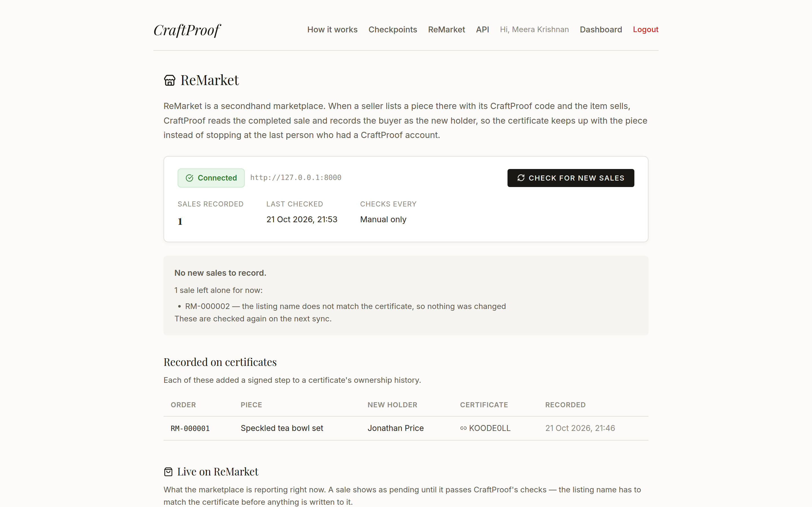
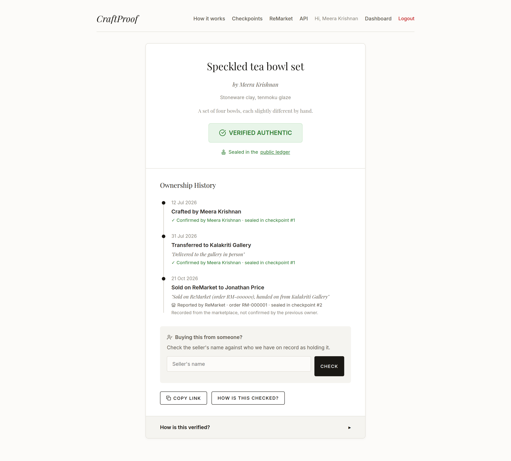
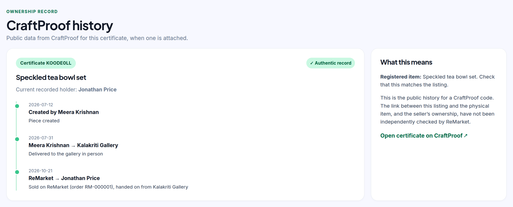
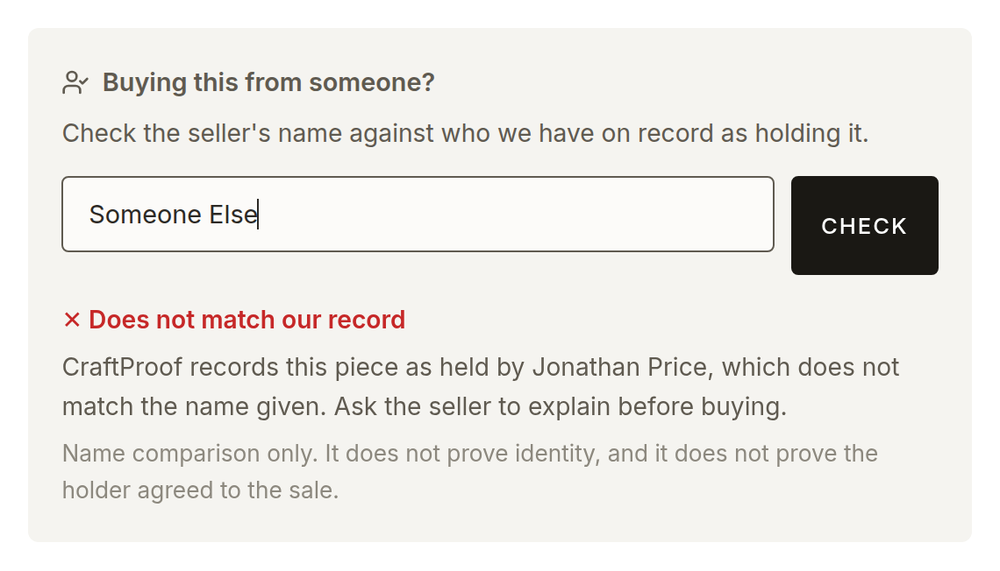

# CraftProof — Complete Workflow Guide

A step-by-step walkthrough of the entire product journey with real screenshots:
a maker registers a piece, hands it to a gallery, the gallery sells it to a
customer, the history is sealed into the public ledger — then someone tampering
with the records gets caught, and finally the piece is resold on a partner
marketplace and that sale lands on the certificate too.

All demo accounts use the password **`craftproof123`**.

| Role | Name | Email |
|---|---|---|
| Maker | Meera Krishnan | `meera@example.com` |
| Seller (gallery) | Priya Nair — *Kalakriti Gallery* | `priya@example.com` |
| Buyer | Jonathan Price | *(no account needed — that's the point)* |
| Marketplace | ReMarket | *(partner site; buys and sells secondhand)* |

---

## Part 1 — The maker: registering a piece

### Step 1 · Landing page

Anyone can visit the app. Makers and sellers sign up or log in; everyone else
can look up a certificate code straight from the front page.


### Step 2 · The maker logs in

Meera is a maker. On the login page she enters her email and password — no
keys, no jargon. Her signing key is managed invisibly by the app.


### Step 3 · Her studio dashboard

The dashboard shows what she currently holds, plus everything she has ever
made ("Pieces You've Made") with live certificates still attached.


### Step 4 · Registering a new piece

She clicks **+ Register New Piece** and fills in a simple form: title,
materials, and the story of the piece.


### Step 5 · Certificate created

Behind the scenes, CraftProof has:
1. created the piece and its **genesis custody record** ("Crafted by Meera"),
2. **signed** it with Meera's key,
3. generated a unique certificate code (`MV1E1MC0` here) and a **QR code**
   pointing at the public certificate page.


The piece card shows the QR tag, ready to print and attach to the physical
object (**Download Tag** renders it as a PNG with the code underneath).


---

## Part 2 — The handover: maker → gallery

### Step 6 · Transferring to a gallery

Meera clicks **Transfer** on the brooch's card, picks **Kalakriti Gallery**
from the dropdown of registered users, and adds an optional delivery note.


Clicking **Confirm & Sign Transfer** appends a second custody record — linked
to the first by its hash and signed *by Meera*, the outgoing custodian.

### Step 7 · It's out of her hands

The brooch leaves her inventory and moves to "Pieces You've Made", now
reading *"Now with Kalakriti Gallery · 1 handover"*.


---

## Part 3 — The gallery: selling to a customer

### Step 8 · The gallery logs in

Priya logs in as Kalakriti Gallery. The brooch is now in her inventory.


### Step 9 · Selling to a buyer with no account

Priya clicks **Transfer**, leaves the recipient as **"-- External Buyer (no
account) --"**, and types the customer's name. The protocol only needs the
*outgoing* party to sign, so Jonathan never has to create an account.


### Step 10 · Sale recorded

The brooch leaves the gallery's inventory. The certificate now has three
custody records: crafted → gallery → customer.


---

## Part 4 — Sealing history: the public ledger

### Step 11 · Publishing a checkpoint

On the **Checkpoints** page, anyone (in the demo) can publish a checkpoint:
CraftProof computes a Merkle root over every custody record so far and
publishes it. After this moment, even CraftProof cannot quietly rewrite any
of those records — they wouldn't match the published fingerprint.


Here checkpoint **#4** was published over 23 records; every step of the
brooch's journey now reads *"sealed in checkpoint #4"* on its certificate.

---

## Part 5 — The buyer: verifying with no account

### Step 12 · The public certificate page

This is the heart of the product. Anyone who scans the QR tag — or opens
`/c/MV1E1MC0` — sees the green **VERIFIED AUTHENTIC** badge and the complete
ownership timeline. No login, no app, no jargon. The badge is computed by a
full server-side verification of every hash, signature and Merkle proof.


### Step 13 · "How is this verified?"

For the curious, the expandable section explains the guarantee in plain
language — no hashes, no signatures, no acronyms:


### Step 14 · How it works page

The `/how-it-works` page walks through the whole idea for a general audience.


---

## Part 6 — The payoff: catching tampering

### Step 15 · Someone edits the past

An attacker (in the demo, the admin script) alters the brooch's
maker → gallery record directly in the database, changing the note to
*"FORGED: bought at a discount store"*:

```bash
# demo-only endpoint, or: python3 tamper_demo.py <piece_id> <seq> "new note"
curl -X POST "http://localhost:8002/admin/tamper/10/1?new_note=FORGED: bought at a discount store"
```

### Step 16 · The certificate turns red

Reloading the certificate page, the green badge is gone. The page shows
**WARNING: ALTERED RECORD**, and the exact tampered step in the timeline is
called out — *"The details of this step were changed after it was confirmed."*


Why? The record's stored hash no longer matches a recomputation of its
content, so the chain is visibly broken.

### Step 17 · Proving it without trusting the server

The green/red badge is computed by the server — so a skeptic could ask: what
if the *server* is the liar? `verify_cli.py` answers that: it pulls the raw
proof data (signed fields, hashes, public keys, Merkle proofs) and re-checks
everything locally.

```bash
cd backend
python3 verify_cli.py MV1E1MC0
```

```text
Certificate MV1E1MC0 — 3 custody record(s)

Record 0: 3 -> Self  (2026-10-05T11:26:33.668069+00:00)
  [PASS] content hash  be8e03f7332b19ac…
  [PASS] chain linkage
  [PASS] Ed25519 signature by Meera Krishnan
  [PASS] Merkle inclusion in checkpoint #4 (root ba259b701e73a4bb…)

Record 1: 3 -> Unknown buyer  (2026-10-05T11:26:36.297944+00:00)
  [FAIL] content hash mismatch — this record was altered after signing
         stored:      5a851414336868d0147fd648a3b58138ad8abaa8b116f83eb641513acf56e3dc
         recomputed:  92e92565e7b711c3d81195ecbda7877615079e365ed48dfd66906dc2928ecf1c
  [PASS] chain linkage
  [PASS] Ed25519 signature by Meera Krishnan
  [PASS] Merkle inclusion in checkpoint #4 (root ba259b701e73a4bb…)

Record 2: 6 -> Jonathan Price  (2026-10-05T11:26:43.449252+00:00)
  [PASS] content hash  84f24b5aa8f143ae…
  [PASS] chain linkage
  [PASS] Ed25519 signature by Priya Nair
  [PASS] Merkle inclusion in checkpoint #4 (root ba259b701e73a4bb…)

RESULT: NOT AUTHENTIC — 1 check(s) failed:
  - record 1: content hash
```

Exactly one check fails — the altered record's content hash — while its
signature and Merkle inclusion still pass. That is the fingerprint of a
tampered-but-genuine record: someone edited the contents of a record whose
signature they could not forge.

---

## Part 7 — The resale: a marketplace sale lands on the certificate

Everything so far happened between people with CraftProof accounts. Most
secondhand sales do not. [ReMarket](https://github.com/arpan-basak/ReMarket) is
a partner marketplace: a seller attaches a CraftProof code to a listing, and
when it sells, ReMarket knows two things CraftProof does not — **who bought it**
and **which order recorded the sale**.

CraftProof reads that feed and appends the buyer. Without it, a piece's history
would stop at the last person who happened to have an account.

### Step 18 · The gallery lists the piece on ReMarket

Kalakriti Gallery lists the *Speckled tea bowl set* on ReMarket and attaches its
certificate code, `KOODE0LL`. A buyer, Jonathan Price, purchases it. Nothing has
reached CraftProof yet — ReMarket never writes to us.

### Step 19 · CraftProof reads the sale

On the **ReMarket** page, *Check for new sales* pulls the feed and imports
anything that passes its checks.



Note the second line. A different seller listed an *iPhone 18 Pro* quoting the
same certificate code, and that sale was **left alone**:

> RM-000002 — the listing name does not match the certificate, so nothing was changed

That is the safety check doing its job. A sale only touches a certificate when
the listing title matches the piece title, so a code copied from someone else's
public certificate page cannot rewrite it. Skipped sales are retried on every
later sync rather than being dropped.

### Step 20 · The certificate records the new owner



A third step has appeared: **Sold on ReMarket to Jonathan Price**, sealed into a
checkpoint like every other record.

Read the line under it carefully:

> Reported by ReMarket · order RM-000002 · Recorded from the marketplace, not
> confirmed by the previous owner.

Every other step says *"✓ Confirmed by …"*. This one does not, and that is
deliberate. The gallery did not sign this handover; a marketplace reported it.
The record is signed by a CraftProof integration account so the chain still
verifies, but nobody reading the certificate is told a marketplace's word came
from the person who handed the piece over.

### Step 21 · Both sites now tell the same story

Back on ReMarket, the listing's own CraftProof panel shows the updated history —
including the sale that ReMarket itself reported.



This is the full round trip in one screenshot. ReMarket calls CraftProof's
public `/api/verify/{code}` to render the history; CraftProof polled ReMarket's
sale feed to learn the last line of it.

ReMarket's own panel is candid about what it has not checked: *"the link between
this listing and the physical item, and the seller's ownership, have not been
independently checked by ReMarket."*

### Step 22 · Checking the seller before you buy

Which leads to the gap neither a certificate nor a marketplace closes on its own.
A certificate proves the piece is genuine. It does **not** prove the person
offering it to you is entitled to sell it — anyone can quote a code they found.

The certificate page has a check for exactly that.



Enter the seller's name and CraftProof compares it against the holder on record.
Here it disagrees, and says so plainly, along with what the check is worth:

> Name comparison only. It does not prove identity, and it does not prove the
> holder agreed to the sale.

The answer has three states, not two. A match, a mismatch, and *"we cannot
answer"* — shown when the chain does not verify or no holder is recorded.
Folding that third state into "mismatch" would accuse a seller because of a
database problem, so it stays separate.

---

## Appendix — Running this yourself

```bash
# backend
cd backend
source venv/bin/activate
uvicorn main:app --port 8002

# frontend
cd frontend
npm install && npm run dev -- --port 5174

# demo data
python3 seed.py            # add demo data
python3 seed.py --reset    # wipe and reseed (all certificates clean again)

# tests / independent verification / tamper demo
python3 test_crypto.py
python3 verify_cli.py <CODE>
python3 tamper_demo.py <piece_id> <seq_index> "altered note"
```

The screenshots in this guide were captured automatically with puppeteer-core
driving system Chrome, so the whole guide can be regenerated at any time:

```bash
# Parts 1-6 (screenshots 01-16): registers the piece, performs every transfer,
# publishes the checkpoint and runs the tamper demo.
node docs/capture_workflow.js

# Part 7 (screenshots 17-20): needs ReMarket running on :8000 with a sale that
# quotes a CraftProof code, and the backend configured to reach it.
node docs/capture_marketplace.js <remarket_product_id> <certificate_code>
```

They are kept as two scripts on purpose: re-running the first regenerates all
sixteen of its screenshots, which churns the repo when only Part 7 needs
refreshing.

## Appendix — Known rough edges noticed while documenting

- When a piece is transferred to a **registered user**, the record stores the
  fallback name *"Unknown buyer"* in `to_name` (the UI resolves it correctly
  via `to_user_id`, but the CLI/proof view shows the fallback). Consider
  storing the recipient's actual name at transfer time.
- Transferring a piece to yourself is correctly rejected ("You already hold
  this piece"), but the buyer-name field is not shown when a registered user
  is selected — intentional, yet easy to misread in a demo.
- `seed.py --reset` prompts interactively; pipe `y` in scripts:
  `echo y | python3 seed.py --reset`.
